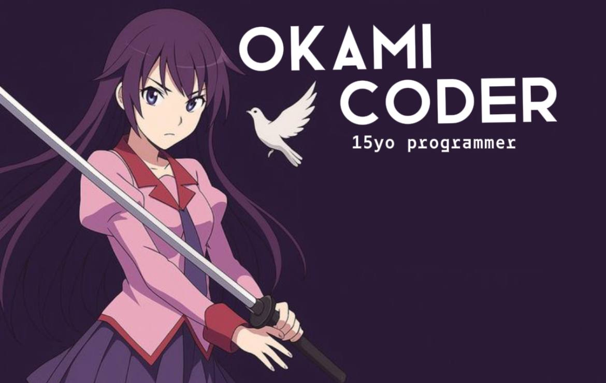

  

# 👋 Hi there, I'm Okami!

I am a 15-year-old **Web & CLI Developer** focused on building fast, automated tools and clean user interfaces. I love writing code that optimizes workflows, runs smoothly in the terminal, or powers modern web platforms.

---

### 🚀 What I Do
- 🌐 **Web Development:** Creating responsive frontend interfaces and robust backend systems.
- 💻 **CLI Tools:** Designing powerful Command Line Interfaces to automate tasks and build utilities.
- ⚡ **Current Focus:** Leveling up software architecture, learning performance optimization, and open-source.

---

### 🧰 Tech Stack & Tools

- **Languages:** JavaScript, Bash, Python.
- **Web Tech:** HTML5, CSS, VueJS
- **Tools & OS:** Git, CachyOs, Docker, VS Code, Vim

---

### 📫 Connect with me

  

